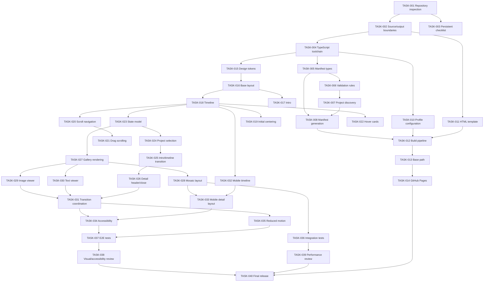

# Project Implementation Plan: Date-Driven Portfolio Timeline

**Project type:** Static portfolio website for GitHub Pages
**Implementation language:** TypeScript, HTML, CSS
**Build system:** Lightweight TypeScript bundler and custom build script
**Primary output:** `dist/index.html`
**Project tracker:** `IMPLEMENTATION_PLAN.md`
**Deployment:** GitHub Pages using GitHub Actions

---

# 1. Project Vision

Build a visually refined, responsive portfolio website organized around a chronological timeline of projects and personal milestones.

The desktop experience centers on a horizontal timeline. Each date is represented by a marker containing the project's featured image. Hovering over a marker reveals a custom-designed preview card with the project's short description.

Selecting a project transitions the page into a project-detail state:

- The introductory profile photo and introduction text animate away toward the top and goes almost out of the viewport, only the 10% of the bottom of it remains visible.
- The timeline moves into the lower portion of the viewport but remains visible.
- The selected date becomes visually active.
- An irregular, art-directed mosaic of project images and text files appears between the introduction area and the timeline.
- Clicking an image opens a large image viewer.
- Clicking a text tile opens a readable text viewer.
- Closing the project returns the interface to the timeline overview, with the timeline centered and horizontal navigation available again.

On mobile devices, the timeline becomes vertical, the introduction stays at the beginning of the page, and project navigation remains usable without horizontal page overflow.

The visual direction is **light editorial minimalism**: generous whitespace, restrained typography, subtle borders, carefully composed images, polished transitions, and a strong emphasis on the work itself.

## 1.1 Non-goals

The initial release will not include:

- A backend or database.
- User accounts or authentication.
- A CMS or browser-based project editor.
- Runtime directory scanning.
- Server-side rendering.
- Third-party analytics or tracking.
- An external image hosting service.
- A requirement to run a server after deployment.

Adding a project should require creating a dated folder, adding its files, and running the build command.

# 2. Core Technical Decisions

1. Use TypeScript, modern CSS, and semantic HTML.
2. Use a lightweight bundler, such as esbuild, with a custom Node.js build script.
3. Generate the final deployable `dist/index.html` during the build.
4. Generate a project manifest from the contents of `projects/`.
5. Embed the generated manifest into the final HTML.
6. Keep project images and text files as separate static assets under `dist/projects/`.
7. Deploy the contents of `dist/` to GitHub Pages.
8. Use no runtime framework unless implementation evidence demonstrates a clear need.
9. Use CSS Grid for the editorial mosaic, with deliberate variation in tile sizes and placement.
10. Use one responsive application state model for overview, project detail, image viewer, and text viewer.
11. Use a horizontal timeline on desktop and a vertical timeline on mobile.
12. Honor `prefers-reduced-motion`.
13. Keep project discovery, validation, and asset copying inside the build process.

**Important:** `dist/index.html` is generated output. Source templates and TypeScript must live elsewhere. Agents must never make manual fixes directly to the generated HTML as a substitute for changing source files.

# 3. Repository Structure

The final repository should follow this structure:

```text
portfolio/
├── README.md
├── IMPLEMENTATION_PLAN.md
├── package.json
├── package-lock.json
├── tsconfig.json
├── .gitignore
│
├── projects/
│   ├── 2026-12-03/
│   │   ├── 0.webp
│   │   ├── 0.txt
│   │   ├── 01-workspace.jpg
│   │   ├── 02-diagram.png
│   │   ├── notes.txt
│   │   └── retrospective.md
│   │
│   └── 2026-11-20/
│       ├── 0.jpeg
│       ├── 0.txt
│       └── screenshot.png
│
├── content/
│   └── profile.json
│
├── assets/
│   └── profile.webp
│
├── src/
│   ├── index.template.html
│   ├── main.ts
│   ├── styles/
│   │   ├── tokens.css
│   │   ├── base.css
│   │   ├── timeline.css
│   │   ├── gallery.css
│   │   ├── overlays.css
│   │   └── responsive.css
│   ├── components/
│   │   ├── Timeline.ts
│   │   ├── Intro.ts
│   │   ├── ProjectGallery.ts
│   │   ├── ImageViewer.ts
│   │   └── TextViewer.ts
│   ├── data/
│   │   └── types.ts
│   ├── services/
│   │   ├── project-data.ts
│   │   └── navigation.ts
│   └── utils/
│       ├── dates.ts
│       ├── paths.ts
│       └── dom.ts
│
├── scripts/
│   ├── build.mjs
│   └── validate-projects.mjs
│
├── tests/
│   ├── unit/
│   ├── integration/
│   └── e2e/
│
└── dist/                       # Generated output; do not edit manually
    ├── index.html
    ├── assets/
    │   └── profile.webp
    └── projects/
        └── ...
```

The exact source-file organization may change during implementation if a simpler design is justified. The external folder contract and generated-output contract must remain stable.

## 3.1 Profile configuration

`content/profile.json` contains the introduction content:

```json
{
  "name": "Your Name",
  "headline": "Engineer, builder, and curious human.",
  "intro": "A short introduction about who you are, what you build, and what interests you.",
  "image": "assets/profile.webp",
  "imageAlt": "Portrait of Your Name"
}
```

All fields must be validated by the build process. The profile image path must resolve to an existing, supported image inside the repository.

The introduction is not a dated project and must never create a timeline marker.

# 4. Project Folder Contract

## 4.1 Date directories

Every project directory must be named using the exact format:

`YYYY-MM-DD`

Examples:

- `2026-12-03`
- `2025-04-17`
- `2024-01-01`

The date must be a real calendar date. Invalid dates, unexpected directory names, and duplicate dates must be reported by the validator.

The folder date is the canonical project date. Do not derive project dates from image metadata, filesystem modification timestamps, or file contents.

## 4.2 Required files

Each visible project must contain:

- `0.txt` — required short project description.
- One featured image whose basename is `0` and whose extension is supported.

Valid examples:

```text
0.jpg
0.jpeg
0.png
0.webp
0.avif
```

The supported extensions must be defined in one central build configuration.

If `0.txt` is missing, the build must report a project validation error.

If `0.txt` exists but no valid featured image exists, the build must report a project validation error. It must not silently publish a broken timeline marker.

If multiple supported files share the basename `0`, the validator must report an ambiguity rather than choosing an arbitrary file. The project author must retain exactly one featured image.

An empty or whitespace-only `0.txt` must also be reported as invalid.

## 4.3 Other project files

Every supported image and text file in an eligible project directory should appear in the gallery, except:

- The featured image already represented by the timeline marker.
- `0.txt`, which is metadata for the timeline and is not a gallery tile.
- Unsupported formats.
- Hidden files and directories.
- Generated system files such as `.DS_Store`.

The featured image can optionally be included in the gallery if that produces a better editorial composition, but this must be a deliberate, documented choice. The default is to exclude it to avoid duplication.

### Supported images

Initial support should include common raster formats:

- JPEG and JPG
- PNG
- WebP
- AVIF
- GIF

SVG support is optional and should not be added without explicit security and rendering tests.

### Supported text files

Initial support should include:

- `.txt`
- `.md`
- `.markdown`

Text files must be displayed as text, not interpreted as HTML or executed as code. Markdown rendering, if added, must use a safe renderer that sanitizes generated HTML. The simplest first release may display Markdown as plain text.

Text file names should be displayed on their gallery tiles, with a short preview where appropriate.

If there's a text file with the same name as an image file, the text should be displayed as complementary content beneath the image, like a caption. The text file should not be interpreted as a separate gallery tile in this case.

## 4.4 Example project

```text
projects/2026-12-03/
├── 0.webp                 # Featured timeline image
├── 0.txt                  # Required short description
├── architecture.png
├── deployment.webp
├── notes.txt
└── retrospective.md
```

`0.txt`:

```text
Designed and launched a new architecture for a distributed event-processing system.
```

The date displayed to the user must be derived from `2026-12-03`, then formatted for the selected locale.

# 5. Architecture and Build Pipeline

## 5.1 Source-to-output flow

```text
projects/ + content/ + assets/ + src/
                    |
                    v
           Project validation
                    |
                    v
           Manifest generation
                    |
                    v
         TypeScript and CSS bundling
                    |
                    v
         HTML template assembly
                    |
                    v
            Static asset copying
                    |
                    v
                 dist/
                    |
                    v
             GitHub Pages
```

The build pipeline must:

1. Read and validate the profile configuration.
2. Scan project directories.
3. Validate directory names and required files.
4. Fail if `0.txt` file is missing inside a project.
5. Validate featured images and supported content files.
6. Generate a deterministic project manifest.
7. Bundle TypeScript into browser-compatible JavaScript.
8. Assemble the final HTML from the source template.
9. Inline the required JavaScript and CSS into `dist/index.html`, where practical.
10. Embed the generated manifest safely in the HTML.
11. Copy the eligible project assets and profile image into `dist/`.
12. Produce a deployable site without runtime build dependencies.

The final HTML should be usable from GitHub Pages without a separate JavaScript bundle or CSS file if practical. Project images and text files remain external static resources, avoiding unnecessarily enormous HTML documents.

## 5.2 Suggested commands

Define these scripts in `package.json`:

```json
{
  "scripts": {
    "validate": "node scripts/validate-projects.mjs",
    "build": "node scripts/build.mjs",
    "test": "vitest run",
    "test:e2e": "playwright test",
    "dev": "vite --host 127.0.0.1",
    "check": "npm run validate && npm run test && npm run build"
  }
}
```

These commands are an initial interface contract. Agents may adjust the implementation and exact dependencies, but must preserve the expected functionality and document any changes.

The build must be reproducible. Running it twice with unchanged inputs should produce equivalent output, apart from any intentionally generated timestamps—which should preferably be omitted.

## 5.3 Manifest schema

Use a versioned manifest:

```typescript
type ProjectAsset =
  | {
      type: "image";
      name: string;
      path: string;
      mimeType: string;
    }
  | {
      type: "text";
      name: string;
      path: string;
      mimeType: string;
    };

interface Project {
  id: string;
  date: string;
  description: string;
  featuredImage: string;
  assets: ProjectAsset[];
}

interface ProjectManifest {
  schemaVersion: 1;
  projects: Project[];
}
```

Requirements:

- `id` must be stable and derived from the folder date.
- `date` must use ISO format: `YYYY-MM-DD`.
- `description` must contain the trimmed contents of `0.txt`.
- `featuredImage` must point to the featured image.
- Asset paths must be relative to the deployed site.
- Projects must be sorted in descending chronological order.
- Assets must be sorted deterministically by filename.
- The manifest must not contain absolute local filesystem paths.
- The embedded manifest must be serialized safely so user content cannot terminate its containing HTML element or inject executable markup.

The schema must be centralized in TypeScript and mirrored by build-time validation where necessary.

## 5.4 GitHub Pages path compatibility

The site must work both at a repository subpath and at a custom domain.

Do not assume the site is hosted at `/`. A repository named `portfolio` may be served at a path such as `/portfolio/`.

Use a configurable base path during the build. All project assets, profile images, and navigation links must resolve correctly under that base path.

Do not generate URLs by blindly concatenating strings or relying on the current page's directory.

# 6. Interaction and Visual Behavior

## 6.1 Overview state

On initial load:

- The profile photo and introduction are visible at the top.
- The timeline occupies the main visual area.
- Projects appear in descending date order.
- The newest project is initially centered in the timeline viewport.
- Each marker displays the featured image, the project date, and a visual indication of the timeline.
- Hovering over a marker displays a custom preview card with the project description.
- The overview remains scrollable and navigable without opening a project.

The initial centering behavior must happen after the manifest and layout are ready, without causing a visible horizontal jump.

If no eligible projects exist, show a designed empty state rather than an empty line.

## 6.2 Desktop timeline

On desktop and sufficiently wide tablets:

- The timeline is horizontal.
- Markers sit along a continuous line.
- Each marker has a date label.
- Featured images are displayed as editorial thumbnails.
- The timeline supports horizontal wheel/trackpad scrolling.
- Mouse dragging scrolls the timeline horizontally.
- Native scrollbar visibility should be a deliberate design choice, not an accidental browser default.
- Mouse dragging must not prevent a normal click on a marker.
- Hover cards must not be clipped by the timeline's scrolling container.

Use CSS scroll snapping only if it improves the experience without interfering with free scrolling or dragging.

The newest project should be centered on initial load, not necessarily the first item in DOM order.

## 6.3 Custom hover card

The hover card must:

- Display the project date and short description.
- Use the light editorial design system.
- Have a subtle entrance animation.
- Position itself intelligently to avoid viewport edges.
- Avoid being clipped by the timeline container.
- Remain usable with keyboard focus.
- Disappear on pointer exit, except when the pointer moves into an interactive part of the card.
- Never depend on the browser's native `title` tooltip.

Hover is an enhancement. On touchscreens, users must be able to open projects directly without hovering.

## 6.4 Project detail state

When a timeline marker is activated:

1. Record the selected project ID.
2. Update the active marker state.
3. Animate the introduction out of the visible composition, moving it upward and fading it away.
4. Move the timeline into a lower section of the viewport.
5. Keep the timeline rendered and usable.
6. Render the project's mosaic between the top of the content area and the timeline.
7. Scroll the document to the appropriate position using a smooth transition, unless reduced motion is requested.
8. Display the selected date prominently.
9. Keep the selected marker visually identifiable.
10. Expose a close button.

The introduction may be visually hidden in this state, but it must remain available in the overview state and must not be duplicated unnecessarily.

The timeline must remain a working navigation control while project details are open. Selecting another marker should switch directly to the new project's content.

When the project detail state opens, focus should move to a sensible heading or project container. When it closes, focus should return to the marker that opened the project.

## 6.5 Editorial mosaic

The gallery should look art-directed, not like a generic collection of identical cards.

Use CSS Grid with predefined placement rules or a deterministic layout algorithm.

The mosaic may contain:

- Large image tiles.
- Medium image tiles.
- Small image tiles.
- Text tiles with varied widths and heights.
- Occasional full-width or featured items.

Avoid arbitrary randomness that changes the composition on every render.

Requirements:

- Preserve image aspect ratios.
- Use appropriate `object-fit` behavior for each tile.
- Avoid layout shifts by defining aspect ratios or dimensions.
- Keep captions and filenames legible.
- Use a responsive grid that adapts to available width.
- Prevent long text from overflowing its tile.
- Ensure every tile is clickable and keyboard accessible.
- Do not use excessive animation that makes browsing slow or distracting.

An image-heavy project and a text-heavy project should both look intentional.

## 6.6 Image viewer

Clicking an image tile opens a large image viewer.

Requirements:

- Display the image at the largest reasonable size within the viewport.
- Preserve its aspect ratio.
- Provide a visible close button.
- Support Escape to close.
- Support left/right arrow navigation between gallery images where practical.
- Support clicking the backdrop to close, but not clicking the image itself.
- Prevent background scrolling while the modal is open.
- Restore focus to the tile that opened the viewer.
- Use a semantic dialog or equivalent accessible modal pattern.
- Provide appropriate alternative text.

If an image fails to load, show a useful fallback and allow the viewer to close normally.

## 6.7 Text viewer

Clicking a text tile opens a readable text viewer.

Requirements:

- Load text from the corresponding static asset.
- Display the filename and project date.
- Preserve meaningful whitespace and line breaks.
- Use a readable maximum line length.
- Allow long documents to scroll inside the viewer.
- Provide a close button and Escape support.
- Prevent HTML execution and script injection.
- Handle failed fetches and missing files gracefully.
- Avoid refetching the same document unnecessarily during a single session if caching is appropriate.

The viewer must not interpret arbitrary text content as trusted HTML.

## 6.8 Closing project details

When the close button is activated:

1. Close any open image or text viewer.
2. Animate the project gallery out.
3. Restore the introduction photo and text.
4. Return the timeline to its overview position.
5. Restore the timeline's horizontal scrolling behavior on desktop.
6. Remove the active project state.
7. Restore focus to the previously active marker, where applicable.

The close action must be repeatable and safe even when transitions are interrupted.

If the user selects another project during a transition, the application must resolve the new state cleanly rather than leaving multiple galleries or conflicting animations visible.

## 6.9 Mobile layout

At the mobile breakpoint, the timeline becomes vertical.

Requirements:

- Profile photo and introduction appear at the beginning of the page.
- The timeline is arranged vertically with markers connected by a vertical line.
- Projects appear in chronological order, newest first.
- The selected project's date remains visible.
- The gallery adapts to a narrower layout.
- The close button remains easy to reach.
- No horizontal page overflow is introduced.
- Image and text viewers fit within the viewport.
- Hover-only functionality is never required.
- The interface supports touch scrolling and taps.
- The intro and timeline transitions must not cause unexpected viewport jumps.

The timeline must remain present during project-detail navigation, including on mobile. Its position and layout may change responsively, but it must not disappear merely because a project is active.

The mobile layout must be designed explicitly rather than produced by shrinking the desktop layout.

## 6.10 State model

Implement a single, explicit application state model.

A suggested model is:

```typescript
type ViewState =
  | { mode: "overview" }
  | {
      mode: "project";
      projectId: string;
    }
  | {
      mode: "image";
      projectId: string;
      assetIndex: number;
    }
  | {
      mode: "text";
      projectId: string;
      assetPath: string;
    };
```

The image and text viewer states imply that a project is active. The implementation may instead model overlays as a separate field if that produces simpler transitions.

Do not create separate competing booleans such as `isProjectOpen`, `isImageOpen`, `isTextOpen`, and `isIntroHidden` without a clear consistency model.

The UI must always have one unambiguous active state.

# 7. Accessibility Requirements

Accessibility is a release requirement, not a final polish task.

Implement the following:

- Semantic HTML landmarks: header, main, navigation, and sections where appropriate.
- A logical heading hierarchy.
- Keyboard-operable timeline markers and gallery tiles.
- Visible focus indicators.
- Accessible names for icon-only buttons.
- Appropriate `alt` text for the profile photo and meaningful project images.
- Empty alternative text for purely decorative images.
- Accessible dialog labels.
- Focus management when opening and closing project views.
- Escape-key support for modal viewers.
- Sufficient color contrast for text, controls, and focus indicators.
- Reduced-motion support through `prefers-reduced-motion`.
- Touch targets sized appropriately for mobile.
- No interaction that depends exclusively on hover.
- No keyboard traps.
- No focus loss when content changes.

The horizontal timeline must remain keyboard accessible even if the scrollbar is hidden.

If the selected project changes, announce meaningful state changes to assistive technology without creating excessively noisy live regions.

Automated accessibility checks must be supplemented by manual keyboard testing.

# 8. Security and Reliability

## 8.1 Content safety

All project text and descriptions are untrusted input.

- Never inject raw project text using `innerHTML`.
- Prefer `textContent` and safe DOM construction.
- Do not execute content from project files.
- If Markdown rendering is implemented, sanitize the resulting HTML.
- Escape manifest data correctly when embedding JSON inside HTML.
- Do not permit project content to introduce arbitrary scripts or event handlers.

## 8.2 Path safety

The build process must:

- Resolve paths relative to the repository root.
- Reject asset paths that escape the allowed source directories.
- Reject absolute paths and traversal sequences in generated asset URLs.
- Avoid copying symbolic links that resolve outside the repository.
- Ensure every manifest asset resolves to a real supported file.
- Normalize generated URLs for GitHub Pages.
- Fail clearly when required configuration is missing.

Do not derive arbitrary filesystem paths from user-controlled browser input.

## 8.3 Runtime reliability

- Handle missing or corrupt project assets.
- Handle failed text fetches.
- Handle empty project lists.
- Avoid uncaught errors during state transitions.
- Clean up event listeners and observers when no longer needed.
- Avoid unnecessary global variables.
- Avoid relying on browser-specific APIs without a fallback or documented support requirement.

## 8.4 Performance

- Keep the JavaScript bundle small.
- Avoid heavyweight UI frameworks and animation libraries.
- Lazy-load nonessential gallery images.
- Do not lazy-load the currently visible featured image if doing so harms initial rendering.
- Use image dimensions or aspect ratios to minimize layout shift.
- Avoid rendering hidden copies of large galleries.
- Respect browser caching for static assets.
- Avoid fetching all text files before a user opens them.
- Keep animations composited where practical.
- Test on a representative mobile device or mobile emulation.

# 9. Testing Strategy

## 9.1 Unit tests

Test:

- Date directory validation.
- Real calendar date validation.
- Featured-image discovery.
- Missing `0.txt` exclusion.
- Missing featured-image failure.
- Duplicate featured-image detection.
- Empty-description validation.
- Supported file extension detection.
- Deterministic sorting.
- Manifest generation.
- Path normalization.
- Safe JSON embedding.
- Base-path URL generation.

## 9.2 Integration tests

Test the complete build using temporary project fixtures.

Scenarios:

1. One valid project generates one manifest entry.
2. Multiple valid projects sort newest first.
3. A folder without `0.txt` is excluded.
4. A project without a featured image fails validation.
5. Invalid date folders produce clear diagnostics.
6. Text and image assets are copied correctly.
7. Unsupported files are excluded.
8. The profile image is copied.
9. The final HTML contains the expected manifest and bundled code.
10. No generated asset points to a nonexistent file.
11. The build works with a non-root GitHub Pages base path.
12. Repeated builds produce equivalent output.

Tests must use isolated fixtures rather than modifying real portfolio content.

## 9.3 End-to-end tests

Use Playwright or an equivalent browser automation tool.

Test:

- Initial overview rendering.
- Newest project centering.
- Custom hover preview.
- Opening a project.
- Introduction transition.
- Timeline remaining visible.
- Gallery rendering.
- Image viewer opening and closing.
- Text viewer loading and closing.
- Switching between projects.
- Closing the project and restoring overview.
- Mouse drag scrolling.
- Wheel/trackpad horizontal navigation.
- Keyboard navigation.
- Escape behavior.
- Mobile vertical timeline.
- Mobile gallery layout.
- Reduced-motion behavior.
- Missing asset fallbacks.
- Base-path asset loading.

## 9.4 Visual testing

Capture screenshots at representative viewport sizes:

- Desktop: 1440 × 900.
- Laptop: 1280 × 800.
- Tablet: 768 × 1024.
- Mobile: 390 × 844.

Inspect both overview and project-detail states.

Visual acceptance should cover:

- No unintended clipping.
- No horizontal overflow on mobile.
- Stable image dimensions.
- Consistent typography.
- Good whitespace and composition.
- Clear active timeline state.
- Correct overlay layering.
- No introduction/gallery overlap.
- Smooth, non-jarring transitions.

## 9.5 Manual acceptance testing

Before release, manually verify:

- The website works on a deployed GitHub Pages URL.
- The website works under a repository subpath.
- The newest project is centered on desktop.
- Mouse dragging does not trigger accidental project opens.
- The vertical timeline is usable on a touchscreen.
- Closing a project restores the expected overview.
- All supported project text is readable.
- No browser console errors occur during normal use.

# 10. AI Agent Operating Protocol

This section is mandatory for every coding agent working on the repository.

## 10.1 Before starting any task

1. Read this entire `IMPLEMENTATION_PLAN.md`.
2. Inspect the current repository and existing source files.
3. Read the status and dependencies of the relevant task.
4. Identify which tasks are already marked complete.
5. Do not redo completed work unless verification reveals a defect or a later requirement invalidates it.
6. Confirm that all prerequisite tasks are complete.
7. Inspect the existing code before proposing changes.
8. Avoid modifying unrelated files.

## 10.2 While working

- Work only on the assigned task and necessary supporting changes.
- Preserve existing behavior unless the task explicitly changes it.
- Prefer small, focused changes.
- Add or update tests alongside implementation.
- Do not introduce new dependencies without justification.
- Do not mark work complete merely because code was written.
- Run the relevant tests and validation commands.
- Update documentation if the implementation changes an interface or convention.

## 10.3 Before marking a task complete

An agent may check a task only when:

1. Its acceptance criteria are satisfied.
2. Required tests pass.
3. The task's dependencies are complete.
4. Any necessary manual verification has been performed.
5. No known regression remains unresolved.
6. The task status and verification evidence are recorded in this file.

If a test cannot be run, the agent must report the limitation and must not claim the relevant acceptance criteria are fully verified.

## 10.4 When a task is blocked

- Leave the task unchecked.
- Set its status to `BLOCKED`.
- Record the blocker and the next action required.
- Do not mark dependent tasks complete.
- Continue with unrelated tasks only if their dependencies permit it.

## 10.5 Persistent progress tracking

Use the checkboxes below as the canonical completion record.

Task statuses:

- `[ ]` Not completed.
- `[x]` Completed and verified.
- `BLOCKED` Explicitly blocked; do not treat as complete.

A checked task means the agent has verified the task against its acceptance criteria. It does not mean the task can be skipped without checking its recorded status and relevant dependencies.

The plan must be committed to version control alongside implementation changes.

---

# 11. Implementation Backlog

## Phase 0 — Repository discovery and planning

### TASK-001 — Inspect the existing repository

**Dependencies:** None

**Actions:**
- Inspect the repository structure.
- Identify existing build tools, conventions, and deployment settings.
- Determine whether an existing `index.html` or GitHub Pages workflow must be preserved.
- Identify existing project folders and assets.

**Acceptance criteria:**
- [x] Repository structure is documented. — Greenfield repo: the only tracked file is `IMPLEMENTATION_PLAN.md`. No source, build, or content files exist.
- [x] Existing tooling and deployment assumptions are recorded. — No `package.json`, no bundler config, no `.github/` workflows, no `index.html`. Remote is `git@github.com:arefaslani/nasim-portfolio.git` with a single `main` branch; local and remote are in sync at commit `e1618cd`. No GitHub Pages workflow exists yet (TASK-014 will create one).
- [x] No existing content has been overwritten. — Nothing existed to overwrite; inspection was read-only.
- [x] Any conflicts with this plan are documented. — None. The repository is empty, so the plan can be implemented as written.

### TASK-002 — Establish source and generated-output boundaries

**Dependencies:** TASK-001

**Actions:**
- Confirm the source directory layout.
- Establish the `dist/` output contract.
- Define the profile configuration location.
- Define how generated output will be excluded from source control or handled in deployment.

**Acceptance criteria:**
- [x] Source files and generated files have distinct locations. — Source: `src/`, `content/`, `assets/`, `projects/`, `scripts/`, `tests/`. Generated: `dist/` only. `.gitignore` excludes `dist/` and `node_modules/` from version control.
- [x] The final HTML output path is documented. — `dist/index.html`, produced by `npm run build` (`scripts/build.mjs`).
- [x] Project assets have a defined source and output location. — Source: `projects/<YYYY-MM-DD>/` and `assets/`; output: `dist/projects/<YYYY-MM-DD>/` and `dist/assets/`, copied by the build.
- [x] Generated files will not be edited manually. — `dist/` is untracked and regenerated from source; per the plan, all fixes go through source files.

**TASK-002 decisions (2026-10-17):**
- `dist/` is **not** committed to version control. The GitHub Actions workflow (TASK-014) will build it in CI from a clean checkout and publish it to GitHub Pages. This avoids generated output in git and guarantees every deployment is reproducible from source.
- `content/profile.json` is the profile configuration location, as specified in Section 3.1.

### TASK-003 — Initialize implementation tracking

**Dependencies:** TASK-001

**Actions:**
- Preserve this plan in `IMPLEMENTATION_PLAN.md`.
- Record task statuses and dependencies.
- Define the agent operating protocol.
- Ensure the plan can be updated incrementally.

**Acceptance criteria:**
- [x] All task IDs are unique. — Verified by script: 40 unique IDs, TASK-001 through TASK-040.
- [x] All dependencies refer to valid task IDs. — Verified by script: every `Dependencies:` reference resolves to an existing task; no self-dependencies.
- [x] The checklist is committed to version control. — Plan and `.gitignore` committed to `main`.
- [x] The agent protocol is present. — Section 10 defines the operating protocol; tasks use the `[ ]` / `[x]` / `BLOCKED` statuses from Section 10.5.

## Phase 1 — Build system and project discovery

### TASK-004 — Set up the TypeScript toolchain

**Dependencies:** TASK-002

**Actions:**
- Initialize `package.json`.
- Configure TypeScript.
- Add a lightweight bundler.
- Configure unit and browser test tooling.
- Add development, build, validation, and test commands.

**Acceptance criteria:**
- [x] TypeScript compiles successfully. — `tsc --noEmit` (TypeScript 7, strict mode) passes on `src/main.ts` and `tests/`.
- [x] Dependency versions are locked. — `package-lock.json` committed; `typescript@^7.0.2`, `esbuild@^0.28.2`, `vitest@^5.0.5` as devDependencies.
- [x] Required npm scripts exist. — `validate`, `build`, `test`, `dev`, `check` from Section 5.2. `test:e2e` (Playwright) is deferred to Phase 8 when it is needed, per the plan's allowance to adjust the initial contract.
- [x] A minimal build and test run succeeds. — `npm run test` passes (1 smoke test), `npm run validate` and `npm run build` run as stubs pending TASK-006/TASK-012.

### TASK-005 — Define shared project and manifest types

**Dependencies:** TASK-004

**Actions:**
- Define `ProjectAsset`, `Project`, and `ProjectManifest`.
- Define supported file extensions.
- Define the project ID and date conventions.
- Document the manifest schema.

**Acceptance criteria:**
- [x] Types are centralized. — `src/data/types.ts` defines `ProjectAsset`, `Project`, `ProjectManifest`, plus the extension lists, date pattern, and required-file constants.
- [x] Build-time and browser-side code use compatible schemas. — Build scripts will import the same constants from `src/data/types.ts` (bundled via esbuild) rather than duplicating them; unit tests pin the values.
- [x] The schema is versioned. — `MANIFEST_SCHEMA_VERSION = 1` with the shape documented in the module header.
- [x] Type checking passes. — `tsc --noEmit` passes; 7/7 unit tests pass (including the manifest shape test).

### TASK-006 — Implement date and filename validation

**Dependencies:** TASK-005

**Actions:**
- Validate strict `YYYY-MM-DD` directory names.
- Validate real calendar dates.
- Identify supported featured-image extensions.
- Identify supported gallery image and text extensions.
- Exclude hidden files and generated system files.

**Acceptance criteria:**
- [x] Valid dates are accepted. — `isValidProjectDirName` accepts `YYYY-MM-DD` real calendar dates, including leap days in leap years.
- [x] Invalid dates are rejected with clear diagnostics. — Malformed formats and impossible dates (`2026-02-30`, `2025-13-01`) are rejected; `scripts/validate-projects.mjs` reports each offending folder and exits 1.
- [x] Unsupported extensions are excluded. — Extension lists are centralized in `src/data/types.ts`; `isSupportedImageFile`/`isSupportedTextFile` classify case-insensitively; hidden and system files are excluded via `isExcludedFileName`.
- [x] Duplicate featured-image candidates are detected. — `findFeaturedImageCandidates` returns all basename-`0` image matches so callers can flag 0-candidate and multi-candidate cases.
- [x] Unit tests cover the edge cases. — 14 new tests: date formats, impossible dates, leap years, extension handling, hidden-file exclusion, featured-image candidates. All 21 tests pass; `tsc --noEmit` clean.

### TASK-007 — Implement project discovery

**Dependencies:** TASK-006

**Actions:**
- Scan the `projects/` directory.
- Identify dated project folders.
- Require a valid, nonempty `0.txt`.
- Find exactly one featured image.
- Collect supported gallery assets.
- Sort assets deterministically.

**Acceptance criteria:**
- [x] Folders without `0.txt` are excluded with a warning. — Verified live: `2025-05-01` (featured image only) is skipped with a warning; eligible projects still build.
- [x] Eligible projects have a valid featured image. — Exactly one basename-`0` image required; 0 candidates and 2+ candidates both produce errors.
- [x] Project descriptions are trimmed. — `0.txt` contents are trimmed; empty/whitespace-only descriptions are validation errors.
- [x] Gallery assets exclude metadata files. — `0.txt`, the featured image, hidden files, and system files are excluded; unsupported files are reported as warnings.
- [x] The discovery process is deterministic. — Folder, file, and asset ordering use fixed code-point sorts; projects sort newest first.
- [x] Automated tests cover all required cases. — 12 new unit tests use an in-memory filesystem (no real fixtures needed); all 33 tests pass, `tsc --noEmit` clean. Verified live against real project folders, including the invalid-date and missing-`0.txt` diagnostics.

### TASK-008 — Generate the project manifest

**Dependencies:** TASK-005, TASK-007

**Actions:**
- Serialize discovered projects into the defined schema.
- Sort projects newest first.
- Generate relative asset URLs.
- Validate every generated reference.
- Safely serialize content for embedding in HTML.

**Acceptance criteria:**
- [x] The generated manifest matches the schema. — `buildManifest` produces `ProjectManifest` (schema v1) from discovered projects; pinned by unit tests.
- [x] Projects are ordered by descending date. — Sorted newest-first in `buildManifest`, independent of discovery order.
- [x] No local absolute paths are exposed. — `toDeployedPath` builds site-relative paths (`projects/<date>/<file>`); tests assert no `/Users/` or `..` in output.
- [x] No manifest path escapes the allowed project directory. — `assertNoTraversal` rejects `..`, `.`, empty segments, and absolute paths; unit-tested.
- [x] Serialization cannot introduce executable HTML through project text. — `safeJsonForHtml` escapes `<`, `>`, `&`, U+2028/2029; tests prove `</script>` payloads cannot close the containing element and content round-trips through `JSON.parse`.
- [x] Integration tests pass. — Integration tests over discovery + manifest generation now exist (TASK-009) and pass; full build-pipeline integration tests follow in TASK-012/TASK-036.

**Implementation notes (TASK-008):**
- Discovery now keeps the full file name on each asset (extension included) so paths, MIME types, and future tile labels derive from one value.
- Empty base path yields site-root-relative paths (no leading slash); a `/repo` base yields domain-root-absolute paths. Final base-path wiring is TASK-013.
- tsconfig target/lib bumped ES2020 → ES2021 for `String.replaceAll`.

### TASK-009 — Create representative project fixtures

**Dependencies:** TASK-007

**Actions:**
- Create isolated test fixtures for valid and invalid projects.
- Include multiple image formats.
- Include text files and Markdown files.
- Include missing metadata and invalid directory names.
- Avoid depending on real personal portfolio content.

**Acceptance criteria:**
- [x] Tests can run without changing real project folders. — Fixtures live in `tests/fixtures/projects/` and are committed; discovery reads them via the real filesystem, never `projects/`.
- [x] Fixtures cover all required validation scenarios. — Three valid projects (image-heavy, single-asset, text-heavy with an XSS payload in `0.txt`), plus invalid-date, missing-`0.txt`, empty-`0.txt`, and ambiguous-featured-image folders, a hidden file, and an unsupported `.zip`.
- [x] Fixture setup and cleanup are reliable. — Fixtures are static, version-controlled files; no setup/cleanup logic, no mutation during tests.
- [x] Integration tests pass. — 10 integration tests in `tests/integration/discovery.integration.spec.ts`: ordering, asset classification, exclusions, all error/warning diagnostics, manifest schema and paths, safe embedding round-trip, and reference resolution against real fixture files. 56/56 tests pass, `tsc --noEmit` clean.

## Phase 2 — Build and deployment

### TASK-010 — Implement the profile configuration

**Dependencies:** TASK-004

**Actions:**
- Add `content/profile.json`.
- Define required profile fields.
- Validate field types and nonempty values.
- Validate the profile image path.
- Ensure the image resolves to a supported asset.

**Acceptance criteria:**
- [x] A valid profile configuration loads successfully. — `content/profile.json` with placeholder values validates; `npm run validate` reports `profile OK`. Committed fixture copy in `tests/fixtures/content/` for tests.
- [x] Missing required fields fail the build. — All five fields (`name`, `headline`, `intro`, `image`, `imageAlt`) must be nonempty strings; unit tests cover each missing/empty field, non-object JSON, and invalid JSON.
- [x] An invalid profile image path fails the build. — Unsupported extensions, hidden files, traversal (`..`), and absolute paths are rejected; a path that does not exist on disk fails via `validateProfileImageResolves`.
- [x] Profile text is treated as untrusted content. — Validation only checks shape; renderers must use `textContent` (enforced in Phase 3+ tasks; documented in `src/lib/profile.ts`).

### TASK-011 — Create the HTML source template

**Dependencies:** TASK-002, TASK-004

**Actions:**
- Create `src/index.template.html`.
- Define the semantic application shell.
- Add the intro, timeline, project gallery, and viewer containers.
- Define the title and metadata.
- Ensure the generated HTML supports the configured base path.

**Acceptance criteria:**
- [x] The template is valid HTML. — Complete document with doctype, lang, charset, viewport, title; tag-balance checked by contract tests.
- [x] All required application regions exist. — Intro (photo, name, headline, text), timeline nav, project detail (date header, close button, mosaic), empty state, image/text viewer dialogs, and a non-executable `#app-data` JSON slot for the manifest.
- [x] The template does not contain hardcoded project data. — All content is injected by the application from the embedded manifest/profile; contract test asserts no project paths or image references in the template.
- [x] The template does not assume deployment at `/`. — `<base href="{{BASE_PATH}}/">` is injected at build time; documented build-token list in the template header.

### TASK-012 — Implement the build pipeline

**Dependencies:** TASK-008, TASK-010, TASK-011

**Actions:**
- Run project validation.
- Generate the manifest.
- Bundle TypeScript.
- Bundle CSS.
- Assemble the final HTML.
- Embed the manifest safely.
- Copy eligible project assets and the profile image.
- Produce `dist/index.html`.

**Acceptance criteria:**
- [x] A clean build generates a deployable `dist/`. — `dist/index.html` plus `assets/profile.webp` and `projects/<date>/…`, built from a temp root in integration tests with no local state.
- [x] The final HTML contains the required application code. — Bundled (minified, esbuild) JS and concatenated CSS are inlined; contract verified by integration tests.
- [x] The manifest is available without a runtime build step. — Embedded safely via `safeJsonForHtml` into the non-executable `#app-data` element; every `{{token}}` is replaced.
- [x] All referenced static assets exist in the output. — Exactly the manifest-referenced files (featured image + gallery assets) are copied; unsupported files, hidden files, and `0.txt` are excluded.
- [x] Build failures are explicit and actionable. — Profile problems, invalid project folders, and bad base paths exit 1 with named diagnostics (integration-tested).
- [x] Running the build twice yields equivalent output. — Integration test compares file lists, sizes, and contents across repeated builds.

### TASK-013 — Implement base-path support

**Dependencies:** TASK-012

**Actions:**
- Define a build-time base-path setting.
- Normalize it.
- Apply it to asset URLs.
- Support a root-domain deployment and a repository-subpath deployment.

**Acceptance criteria:**
- [x] Asset URLs work at `/`. — Empty base produces site-relative paths (`projects/…`, no leading slash) and `<base href="/">`; integration-tested.
- [x] Asset URLs work under a repository prefix. — `--base /portfolio` produces `<base href="/portfolio/">` and `/portfolio/projects/…` URLs; assets still copy to the dist root (dist is the site root, the prefix is deployment-only); integration-tested.
- [x] No accidental double slashes or malformed paths occur. — Integration tests assert no `"//` or `/portfolio//` sequences; `normalizeBasePath` rejects trailing/embedded slashes and traversal.
- [x] Automated tests verify both configurations. — `tests/integration/basepath.integration.spec.ts` covers root, subpath, `PORTFOLIO_BASE_PATH` env var, and malformed-base rejection.

**Implementation notes (TASK-013):**
- The base path can be configured three ways: `--base` flag, `PORTFOLIO_BASE_PATH` environment variable (used by the TASK-014 workflow), or empty default.

### TASK-014 — Configure GitHub Pages deployment

**Dependencies:** TASK-012, TASK-013

**Actions:**
- Add a GitHub Actions workflow.
- Install locked dependencies.
- Run validation and tests.
- Build the site.
- Publish `dist/` to GitHub Pages.
- Document repository Pages settings and required permissions.

**Acceptance criteria:**
- [x] The workflow builds from a clean checkout. — `actions/checkout` + `npm ci` (locked deps) on ubuntu-latest, Node 24. YAML linted; full confirmation on first CI run.
- [x] Failed tests prevent deployment. — The `deploy` job `needs: build`, and `build` runs `npm run check` (validate + tests + build); any failure stops the workflow before the Pages artifact is published.
- [x] Successful builds publish the generated output. — `actions/upload-pages-artifact@v3` uploads `dist/`; `actions/deploy-pages@v4` publishes it.
- [ ] The deployed site loads under the expected URL. — Pending first push to `main` (workflow triggers on push). To verify after pushing: the Actions run must be green and `https://arefaslani.github.io/nasim-portfolio/` must load.
- [ ] Project assets resolve correctly on the deployed site. — Pending live verification at the deployed URL (base path `/nasim-portfolio/` is configured in the workflow).

## Phase 3 — Design system and application shell

### TASK-015 — Define design tokens

**Dependencies:** TASK-004

**Actions:**
- Establish typography, spacing, colors, borders, radii, and shadows.
- Use a light editorial visual direction.
- Define responsive breakpoints.
- Define transition durations and easing curves.
- Establish focus and active-state styling.

**Acceptance criteria:**
- [x] Shared design tokens exist. — `src/styles/tokens.css`: color (near-monochrome ink/paper + one accent), type scale with display/body/mono stacks, 4px-based spacing scale, radii, three shadow levels, motion durations/easings, focus ring, layout widths.
- [x] Components use tokens rather than arbitrary repeated values. — `base.css` consumes tokens exclusively; component styles (TASK-016+) will be held to the same rule by review.
- [x] Text and controls meet contrast requirements. — `--color-ink` (#1a1817) on `--color-bg` (#faf9f7) ≈ 15.7:1; `--color-ink-muted` (#6b6560) on bg ≈ 5.3:1 (AA); accent #2f5d50 on white ≈ 6.9:1. Formal audit is TASK-038.
- [x] Focus states are visually clear. — Global `:focus-visible` with the accent ring token plus offset; skip link styled.

**Implementation notes (TASK-015):**
- Breakpoints are documented values in a comment (mobile ≤639px, tablet 640–1023px, desktop ≥1024px) because media queries cannot consume custom properties.
- Global `prefers-reduced-motion: reduce` guard added in base.css.

### TASK-016 — Implement base styling and semantic layout

**Dependencies:** TASK-011, TASK-015

**Actions:**
- Define global typography and page sizing.
- Implement semantic landmarks.
- Establish responsive container widths.
- Avoid horizontal page overflow.
- Define baseline loading and empty states.

**Acceptance criteria:**
- [x] The page shell renders at desktop and mobile sizes. — Centered shell with `--page-max-width` and fluid `--page-gutter` gutters; flex column layout for header/main/nav stacking; verified in the built output (pixel review is TASK-038's visual pass).
- [x] Semantic landmarks are present. — `header` (intro), `main` (content), `nav` (timeline) from the TASK-011 template, now laid out as page regions.
- [x] No unnecessary horizontal overflow occurs. — `overflow-x: hidden` on body as a guard plus constrained column layout; explicit per-component overflow checks come with the timeline/mosaic tasks.
- [x] Empty-state styling is available. — Designed quiet empty state (`#empty-state`) using display type and muted ink.

### TASK-017 — Implement the introduction component

**Dependencies:** TASK-010, TASK-015, TASK-016

**Actions:**
- Display the profile photo.
- Display the name, headline, and introduction.
- Create an editorial composition with appropriate whitespace.
- Add a transition-ready container.
- Provide suitable image alternative text.

**Acceptance criteria:**
- [x] Profile content comes from configuration. — `src/components/Intro.ts` renders from the embedded profile (build embeds `{ manifest, profile }` into `#app-data` via `safeJsonForHtml`); `src/services/project-data.ts` parses it null-safely.
- [x] The image and text adapt to mobile. — Photo + text side-by-side on desktop, stacked below 640px; fluid photo size with `clamp()`.
- [x] The introduction has no hardcoded project data. — Everything renders from `content/profile.json`; nothing else is referenced.
- [x] Its visibility can be controlled by application state. — `setIntroHidden(doc, hidden)` toggles `data-hidden` with a token-driven transition (full choreography in TASK-025).

**Implementation notes (TASK-017):**
- The template's `{{MANIFEST_JSON}}` token became `{{APP_DATA_JSON}}` carrying `{ manifest, profile }` in the single `#app-data` JSON slot.
- All profile text renders via `textContent` (Section 8.1).

## Phase 4 — Timeline

### TASK-018 — Implement timeline data rendering

**Dependencies:** TASK-008, TASK-015, TASK-016

**Actions:**
- Render the project markers.
- Display the featured image and date.
- Render the timeline line and active marker state.
- Provide an empty state when there are no projects.
- Ensure stable project identity.

**Acceptance criteria:**
- [ ] Every eligible manifest entry produces one marker.
- [ ] Markers appear newest first.
- [ ] Dates use the folder date.
- [ ] Active state is visually distinct.
- [ ] Broken featured images have a graceful fallback.

### TASK-019 — Center the newest project on initial load

**Dependencies:** TASK-018

**Actions:**
- Wait until timeline dimensions are available.
- Center the newest marker horizontally on desktop.
- Avoid visible initial jumps.
- Handle empty timelines.
- Avoid repeated auto-centering after the user begins navigating.

**Acceptance criteria:**
- [ ] The newest project is centered on initial desktop load.
- [ ] The behavior works with varying marker counts.
- [ ] No invalid scrolling occurs when the timeline is empty.
- [ ] User-initiated scrolling is not repeatedly overridden.

### TASK-020 — Implement horizontal wheel and trackpad navigation

**Dependencies:** TASK-018, TASK-019

**Actions:**
- Support horizontal scrolling.
- Translate appropriate vertical wheel movement into horizontal timeline movement where it improves desktop usability.
- Preserve ordinary vertical page scrolling when the pointer is outside the timeline.
- Avoid interfering with nested scrollable content.

**Acceptance criteria:**
- [ ] Horizontal trackpad gestures work naturally.
- [ ] Mouse-wheel navigation works when appropriate.
- [ ] Page scrolling remains usable.
- [ ] Nested text and modal scrolling are not hijacked.

### TASK-021 — Implement mouse drag scrolling

**Dependencies:** TASK-020

**Actions:**
- Add pointer-based drag scrolling for desktop.
- Track the drag threshold.
- Distinguish click from drag.
- Prevent accidental text selection during dragging where necessary.
- Clean up pointer state reliably.

**Acceptance criteria:**
- [ ] Users can drag the timeline horizontally.
- [ ] A click without meaningful movement activates the marker.
- [ ] A drag does not accidentally open a project.
- [ ] Pointer release outside the timeline does not leave it stuck in a dragging state.

### TASK-022 — Implement custom project hover cards

**Dependencies:** TASK-018, TASK-015

**Actions:**
- Show the description from `0.txt`.
- Display the date and a featured-image preview where appropriate.
- Animate the card in and out.
- Prevent viewport-edge clipping.
- Support keyboard focus.
- Disable hover-only expectations on touchscreens.

**Acceptance criteria:**
- [ ] The card is custom-styled, not a native tooltip.
- [ ] Correct text appears for each project.
- [ ] The card does not obstruct essential controls.
- [ ] Keyboard users receive equivalent project information.
- [ ] Reduced-motion settings are respected.

## Phase 5 — Project navigation and detail layout

### TASK-023 — Implement the application state model

**Dependencies:** TASK-018, TASK-017

**Actions:**
- Implement the overview and project states.
- Add image and text viewer states.
- Define valid transitions.
- Define focus restoration targets.
- Prevent conflicting overlay states.

**Acceptance criteria:**
- [ ] Only one application view state is active at a time.
- [ ] Opening and closing transitions are deterministic.
- [ ] Changing projects does not leave stale UI behind.
- [ ] Invalid project IDs are handled safely.

### TASK-024 — Open a project from a timeline marker

**Dependencies:** TASK-023, TASK-022

**Actions:**
- Activate a project on click, tap, or keyboard input.
- Set the selected project.
- Update the active marker.
- Expose the selected date.
- Move focus to the project heading or detail region.

**Acceptance criteria:**
- [ ] Every eligible marker opens its project.
- [ ] The correct project data is selected.
- [ ] Focus moves to a meaningful destination.
- [ ] Repeated activation does not duplicate the gallery.

### TASK-025 — Animate the introduction out and timeline down

**Dependencies:** TASK-017, TASK-024

**Actions:**
- Animate the introduction upward and fade it out.
- Reposition the timeline into the lower viewport region.
- Keep the timeline rendered and usable.
- Coordinate the animation with document scrolling.
- Avoid abrupt layout shifts.

**Acceptance criteria:**
- [ ] The intro disappears from the visible composition.
- [ ] The timeline remains visible during project detail.
- [ ] The active date remains identifiable.
- [ ] Animation and scrolling work together without visible jumps.
- [ ] Reduced-motion mode provides an appropriate nonanimated transition.

### TASK-026 — Implement project detail header and close control

**Dependencies:** TASK-024, TASK-025

**Actions:**
- Display the active project date.
- Add an accessible close button.
- Define close-transition behavior.
- Restore the overview layout and focus.
- Handle repeated clicks and interrupted transitions.

**Acceptance criteria:**
- [ ] The active date is visible.
- [ ] The close button is keyboard accessible.
- [ ] Closing restores the intro.
- [ ] The timeline returns to the overview position.
- [ ] Focus returns to the opening marker when appropriate.

## Phase 6 — Gallery and content viewers

### TASK-027 — Implement gallery asset rendering

**Dependencies:** TASK-008, TASK-023

**Actions:**
- Render image and text assets for the selected project.
- Exclude `0.txt` and, by default, the featured image.
- Create accessible, interactive tiles.
- Handle missing assets.
- Provide loading states for text files.

**Acceptance criteria:**
- [ ] Every eligible gallery asset is represented.
- [ ] Unsupported files are excluded.
- [ ] The correct project assets are shown.
- [ ] Tile labels and image alternatives are appropriate.
- [ ] Missing assets do not break the entire gallery.

### TASK-028 — Implement the editorial mosaic layout

**Dependencies:** TASK-027, TASK-015

**Actions:**
- Create a varied CSS Grid composition.
- Define tile size classes.
- Establish deterministic layout rules.
- Adapt the composition for tablet and mobile.
- Prevent overflow and excessive layout shifts.

**Acceptance criteria:**
- [ ] The gallery looks editorial rather than uniformly tiled.
- [ ] Tile sizes vary intentionally.
- [ ] Images preserve their intended proportions.
- [ ] Text tiles remain legible.
- [ ] The layout remains usable at all target viewport sizes.

### TASK-029 — Implement the image viewer

**Dependencies:** TASK-027, TASK-023

**Actions:**
- Open a large image viewer.
- Add a close button and Escape handling.
- Add optional previous/next navigation.
- Prevent background scrolling.
- Restore focus after closing.
- Handle load failures.

**Acceptance criteria:**
- [ ] Every image tile opens the correct image.
- [ ] The image fits the viewport without distortion.
- [ ] The viewer can be closed using the button and Escape.
- [ ] Clicking the image does not accidentally close it.
- [ ] Focus is restored after closing.

### TASK-030 — Implement the text viewer

**Dependencies:** TASK-027, TASK-023

**Actions:**
- Load the selected text file.
- Display its filename and project date.
- Preserve whitespace and line breaks.
- Make long text scrollable.
- Add error and loading states.
- Render content as plain text or sanitized Markdown.

**Acceptance criteria:**
- [ ] Clicking a text tile opens the correct file.
- [ ] Text is readable on desktop and mobile.
- [ ] HTML-like text is never executed.
- [ ] Loading and fetch errors are handled.
- [ ] The viewer can be closed using the button and Escape.

### TASK-031 — Implement overlay and transition coordination

**Dependencies:** TASK-029, TASK-030, TASK-026

**Actions:**
- Coordinate image and text viewers with project detail state.
- Ensure overlays close before returning to overview.
- Prevent duplicate scroll locks.
- Ensure focus restoration works across nested states.
- Prevent transitions from leaving the page in an inconsistent state.

**Acceptance criteria:**
- [ ] Viewer states cannot conflict.
- [ ] Closing an overlay returns to project detail when appropriate.
- [ ] Closing project detail restores the overview.
- [ ] Background scrolling is correctly restored.
- [ ] Interrupted transitions remain safe.

## Phase 7 — Responsive behavior and accessibility

### TASK-032 — Implement the vertical mobile timeline

**Dependencies:** TASK-018, TASK-015

**Actions:**
- Change the timeline orientation at the mobile breakpoint.
- Place markers along a vertical line.
- Keep dates and thumbnails legible.
- Define mobile marker spacing and touch targets.
- Maintain newest-first ordering.

**Acceptance criteria:**
- [ ] The timeline is vertical on mobile.
- [ ] Project order is preserved.
- [ ] Every marker remains interactive.
- [ ] No horizontal page overflow occurs.
- [ ] The desktop timeline remains horizontal.

### TASK-033 — Implement responsive project detail layout

**Dependencies:** TASK-025, TASK-028, TASK-032

**Actions:**
- Adapt the active project header.
- Keep the selected date visible.
- Position the timeline below the gallery while keeping it present.
- Adapt the close control.
- Coordinate document scrolling with mobile browser viewport behavior.

**Acceptance criteria:**
- [ ] The intro appears first in the mobile overview.
- [ ] Opening a project hides the intro from the visible composition.
- [ ] The vertical timeline remains available during project detail.
- [ ] The gallery fits narrow screens.
- [ ] Closing restores the expected overview position.

### TASK-034 — Complete keyboard and focus behavior

**Dependencies:** TASK-021, TASK-022, TASK-026, TASK-029, TASK-030

**Actions:**
- Implement keyboard-accessible marker activation.
- Add visible focus indicators.
- Implement viewer focus management.
- Add appropriate keyboard navigation.
- Verify focus restoration.

**Acceptance criteria:**
- [ ] The complete interface is operable without a mouse.
- [ ] Focus is always visible.
- [ ] No keyboard traps exist.
- [ ] Dialog focus is managed correctly.
- [ ] Focus is restored after each closing transition.

### TASK-035 — Implement reduced-motion support

**Dependencies:** TASK-015, TASK-025, TASK-026, TASK-031

**Actions:**
- Respect `prefers-reduced-motion`.
- Remove or shorten nonessential transitions.
- Avoid scroll animations that violate the user's preference.
- Keep state transitions understandable without animation.

**Acceptance criteria:**
- [ ] Reduced-motion preferences are respected.
- [ ] All controls remain functional.
- [ ] No essential information depends on animation.

## Phase 8 — Validation and release readiness

### TASK-036 — Complete build and integration tests

**Dependencies:** TASK-009, TASK-012, TASK-013

**Actions:**
- Add complete build-pipeline tests.
- Verify manifest and output consistency.
- Verify base-path support.
- Test failure cases.
- Confirm deterministic output.

**Acceptance criteria:**
- [ ] All build and integration tests pass.
- [ ] Invalid inputs produce actionable errors.
- [ ] Every output reference resolves correctly.
- [ ] Clean builds do not depend on local state.

### TASK-037 — Complete browser end-to-end tests

**Dependencies:** TASK-024, TASK-031, TASK-033, TASK-034, TASK-035

**Actions:**
- Implement the end-to-end scenarios from Section 9.
- Test desktop and mobile behavior.
- Verify viewer interactions.
- Verify navigation and focus restoration.
- Test empty and invalid content scenarios.

**Acceptance criteria:**
- [ ] All critical user journeys pass.
- [ ] No console errors occur during normal operation.
- [ ] Desktop and mobile flows are covered.
- [ ] Reduced-motion behavior is tested.

### TASK-038 — Perform visual and accessibility review

**Dependencies:** TASK-028, TASK-033, TASK-034, TASK-035, TASK-037

**Actions:**
- Capture screenshots at the specified viewport sizes.
- Review overview and project-detail states.
- Run automated accessibility checks.
- Perform manual keyboard testing.
- Fix identified visual and accessibility defects.

**Acceptance criteria:**
- [ ] All specified viewports have been reviewed.
- [ ] No critical accessibility defects remain.
- [ ] No unintended overflow or clipping remains.
- [ ] Active timeline and viewer states are visually clear.
- [ ] Remaining noncritical limitations are documented.

### TASK-039 — Optimize performance and asset handling

**Dependencies:** TASK-028, TASK-029, TASK-030, TASK-036

**Actions:**
- Review bundle size.
- Verify lazy loading.
- Check image dimensions and aspect ratios.
- Verify text files are loaded on demand.
- Check caching and layout stability.

**Acceptance criteria:**
- [ ] No unnecessary heavyweight dependencies exist.
- [ ] Gallery images do not create avoidable layout shifts.
- [ ] Text files are not eagerly fetched in bulk.
- [ ] Initial rendering is responsive on a representative mobile device.
- [ ] No known serious performance regression remains.

### TASK-040 — Finalize documentation and deployment

**Dependencies:** TASK-014, TASK-036, TASK-037, TASK-038, TASK-039

**Actions:**
- Document local setup.
- Document how to add a project.
- Document profile configuration.
- Document build and test commands.
- Document deployment and base-path configuration.
- Perform a final clean build and deploy.

**Acceptance criteria:**
- [ ] README contains complete setup instructions.
- [ ] Adding a project requires no source-code changes.
- [ ] `npm run check` succeeds.
- [ ] GitHub Pages deployment succeeds.
- [ ] The deployed website passes the critical acceptance tests.
- [ ] All completed tasks in this plan have accurate statuses.

---

# 12. Dependency Overview

The following dependency graph describes the main implementation order. Individual tasks may proceed in parallel when their dependencies are satisfied.



This graph is a high-level overview. The task-level dependency lists are authoritative if there is a discrepancy.

# 13. Definition of Done

The project is complete only when all of the following conditions hold:

- [ ] The build generates `dist/index.html`.
- [ ] The build generates a valid project manifest.
- [ ] A folder without `0.txt` is excluded.
- [ ] Every visible project has a valid featured image.
- [ ] The newest project is centered on desktop initial load.
- [ ] The timeline supports horizontal scrolling and mouse dragging on desktop.
- [ ] Hover previews are custom-designed and keyboard accessible.
- [ ] Opening a project hides the introduction from the visible composition.
- [ ] The timeline remains visible and usable in project-detail mode.
- [ ] Project images and text files appear in the editorial mosaic.
- [ ] Image and text viewers work and close correctly.
- [ ] Closing a project restores the introduction and overview timeline.
- [ ] The mobile timeline is vertical.
- [ ] The site works at a GitHub Pages repository subpath.
- [ ] Keyboard navigation, focus handling, and reduced motion are supported.
- [ ] Security checks prevent unsafe content rendering and invalid paths.
- [ ] Unit, integration, and critical end-to-end tests pass.
- [ ] The deployed website has been reviewed at desktop and mobile sizes.
- [ ] README instructions are sufficient for adding projects and deploying the site.
- [ ] All required tasks in this implementation plan are marked complete only after verification.

# 14. Adding a New Project After Release

Once the site is complete, adding a project should be a content-only operation.

Example:

```text
projects/
└── 2027-02-14/
    ├── 0.webp
    ├── 0.txt
    ├── architecture.png
    ├── demo.gif
    └── notes.md
```

Steps:

1. Create a folder named with the project date.
2. Add exactly one supported featured image named `0` with an image extension.
3. Add a nonempty `0.txt` description.
4. Add any supported images or text files for the gallery.
5. Run `npm run validate`.
6. Run `npm run build`.
7. Preview the generated site.
8. Commit and push the source changes.
9. Let GitHub Actions deploy the generated `dist/` directory.

No TypeScript changes should be necessary for an ordinary new project.

# 15. Final Instructions for AI Agents

Treat this document as the authoritative implementation plan.

Implement the project incrementally. Start with repository inspection and the build pipeline, then implement the UI in dependency order. Do not attempt to implement the entire website in a single large change.

Before every task, read its dependencies and acceptance criteria. After completing it, run the required checks, update its checkbox and evidence in this document, and commit the relevant changes when appropriate.

Never mark an unverified task as complete. Never redo completed work without a specific reason. If a design or architecture decision must change, update this plan and document the reason before proceeding.

**The final deliverable is a polished, accessible, responsive, date-driven portfolio website whose generated `dist/index.html` and static assets can be deployed directly to GitHub Pages.**
